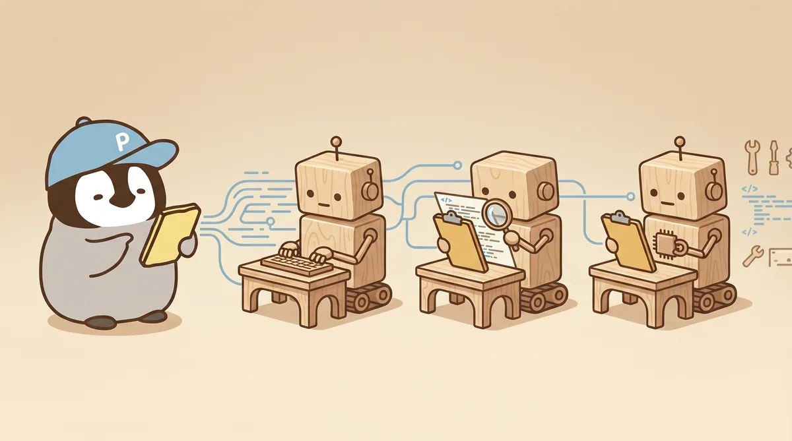
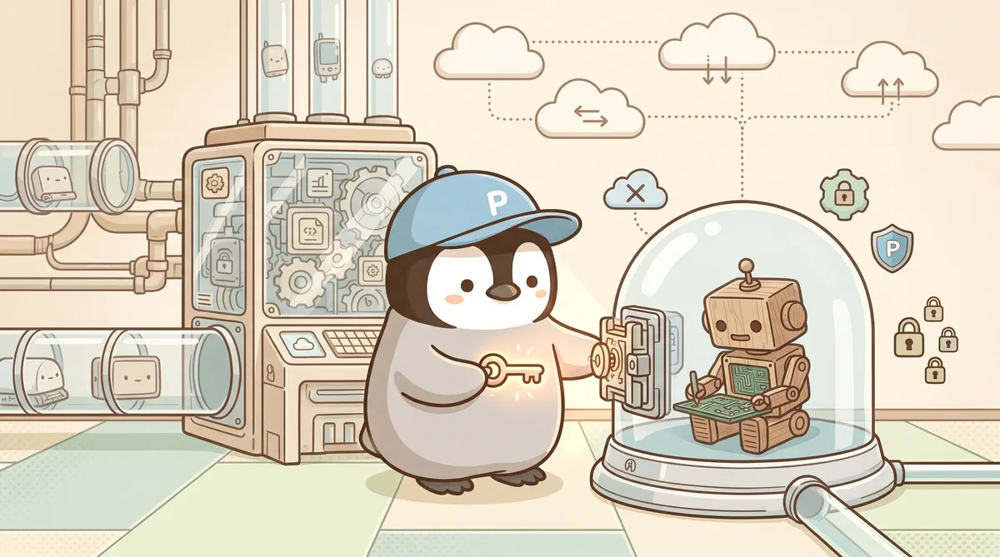
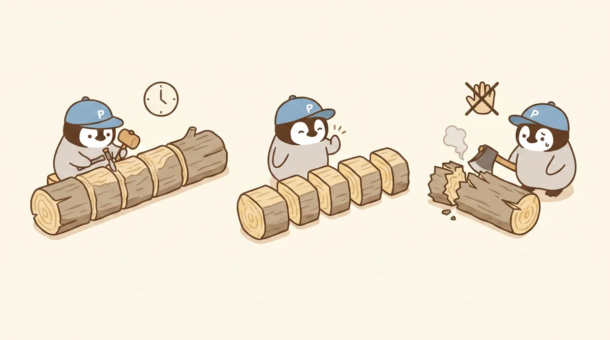
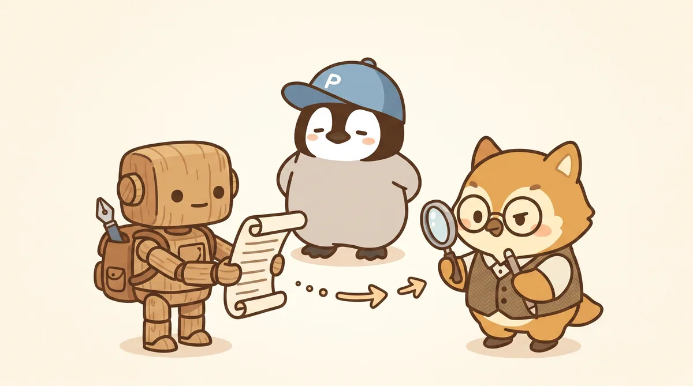

  

# cc-orchestrator

> **🐧 中文版** — [README.zh-TW.md](README.zh-TW.md) · [penchan.co/ai/openclaw/orchestration-playbook](https://penchan.co/ai/openclaw/orchestration-playbook/)

**Run Claude Code as the orchestrator. Use Codex CLI as the worker. This is the playbook for the parts the official docs leave to you.**

If you're already running Claude Code with subagents, you know the easy half: "spawn a subagent and ask it to do X." The hard half is everything around it — when to delegate to Codex instead of a Claude subagent, how to choose effort tier so your weekly credit window lasts, how to keep the sandbox honest about your `npm install`, what "success" actually means in three signals instead of one. That's what this repo is about.

---

## Why this exists

Two of the most capable AI coding stacks in 2026 — Anthropic's Claude Code and OpenAI's Codex CLI — were each designed standalone. They have separate docs. The interaction between them lives in your terminal history.

The natural division of labour, once you've spent a few weeks running both, is:

- **Claude Code** sits on top: planning, reviewing, holding the spec, deciding what's done.
- **Codex CLI** does the code: implementing, refactoring, generating tests, running the long edits.

That sounds clean in a slide. In practice the seams are everywhere — sandbox boundaries, effort tier costs, observability, hook gaps, the way `/compact` can kill a 30-minute session, the way `--full-auto` means a specific approval policy rather than "ask nothing." This repo turns the running notes from doing it for real into patterns you can copy.

## Who this is for

- You use Claude Code as your daily driver and want to start using Codex CLI as a worker with a starter set of rules to extend.
- You hit a Codex sandbox error and want a fast read on whether it's the path, the network, or the policy — so you spend the afternoon shipping instead of guessing.
- You want orchestration patterns that fail loudly when something breaks, so you can act on real signals.

## Scope

| Topic | Where to find it |
|---|---|
| Operational patterns + prompt templates (markdown, no install) | **Here** |
| Codex CLI fundamentals (first-time setup, basic invocation) | [Codex CLI docs](https://developers.openai.com/codex/) |
| Claude Code fundamentals (sessions, subagents, tool use) | [Anthropic Claude Code docs](https://docs.claude.com/en/docs/claude-code/overview) |
| Tested target | Codex CLI 0.124 + Claude Code as of April 2026. The abstract patterns generalise; the operational details (effort tiers, hook event names, sandbox flags) are pinned to those versions. |

---

## Where to start

If you have 5 minutes:

1. Read **[guides/orchestrating-codex.md](guides/orchestrating-codex.md)** — the headline guide. The 4-Lane model (local · worktree · cloud · MCP+hooks), how to pick effort, what a working dispatch actually looks like.
2. Skim **[patterns/coordination/file-blackboard.md](patterns/coordination/file-blackboard.md)** — every multi-agent system needs one. This is the one used here.
3. Pick a problem you actually have and jump to its pattern.

If you have an hour:

| You're stuck on… | Read this |
|---|---|
| Packaging a task for a Codex run that stays on track | [Task Envelope](patterns/coordination/task-envelope.md) |
| Codex burned through retries and ate your credits | [Circuit Breaker](patterns/resilience/circuit-breaker.md) |
| Subagent finished but said nothing useful | [Completion Notification](patterns/communication/completion-notification.md) + [Structured Error Events](patterns/communication/structured-error-events.md) |
| Knowing when Codex can run autonomously vs. when to escalate | [HITL Escalation](patterns/communication/hitl-escalation.md) |
| Long task died mid-way and you have no idea where | [Checkpoint & Resume](patterns/resilience/checkpoint-resume.md) |
| Codex review of its own diff keeps missing things | [Cross-family review](guides/code-review.md) + [Challenge Loop](patterns/coordination/challenge-loop.md) |

---

## What's in here

### `guides/` — when and why

The thinking. Read these when you need to make a decision rather than copy a pattern.

| Guide | When to read |
|---|---|
| **[Orchestrating Codex](guides/orchestrating-codex.md)** | Setting up your CC ↔ Codex loop for the first time, or every time you need to remind yourself which sandbox flag does what |
| [Model Selection](guides/model-selection.md) | Choosing whether this task is Sonnet subagent / Codex `medium` / Codex `xhigh` |
| [Spec-Driven Development](guides/spec-driven-development.md) | Sending a Codex run with more than a one-line prompt — read this first |
| [Code Review](guides/code-review.md) | Why cross-family review beats self-review, and what to set up instead |
| [Development Pipeline](guides/development-pipeline.md) | Phase-based workflow for code and algorithm work |
| [Error Handling](guides/error-handling.md) | The 5-layer fallback pyramid; retry vs. restart vs. escalate |
| [Cost Control](guides/cost-control.md) | Per-task budgets, the credit-window math, anti-patterns that quietly burn money |
| [Context Management](guides/context-management.md) | Keeping prompts under 8K, why you pass paths instead of pasting |
| [Security Guardrails](guides/security-guardrails.md) | Tool permissions, path restrictions, prompt-injection defence |
| [Learning Loop](guides/learning-loop.md) | Turning failures into prevention: debug KB, error SOP, quarterly audits |

### `patterns/` — operational shapes

The patterns are grouped by the problem each one solves. Each pattern is short, has a "when you need it" line, and a worked example where it helps.

**`coordination/` — how the orchestrator and workers fit together**
- [File Blackboard](patterns/coordination/file-blackboard.md) — workspace is the message bus
- [Task Envelope](patterns/coordination/task-envelope.md) — structured packaging for every dispatch
- [Challenge Loop](patterns/coordination/challenge-loop.md) — evidence-based adversarial review

**`resilience/` — how things stay running when one part dies**
- [Circuit Breaker](patterns/resilience/circuit-breaker.md) — stop retry storms before they cost you
- [Checkpoint & Resume](patterns/resilience/checkpoint-resume.md) — survive a session crash mid-task
- [Dead Letter Queue](patterns/resilience/dead-letter-queue.md) — failed tasks stay queued for retry

**`communication/` — how state and failure get reported**
- [Completion Notification](patterns/communication/completion-notification.md) — done means done, said out loud
- [Structured Error Events](patterns/communication/structured-error-events.md) — make failure noisy on purpose
- [HITL Escalation](patterns/communication/hitl-escalation.md) — three-tier human-in-the-loop gating

### `templates/` — copy-paste starting points

Markdown and JSON templates for envelopes, error events, checkpoints, decision cards, and dead letters. Lift one, fill it in, ship.

### `examples/cc-orchestrate-cod/` — the smallest thing that runs

A minimal end-to-end working example: one orchestrator, one Codex worker, file blackboard, circuit breaker, completion notification. Read it once, fork it, replace the task with yours.

---

## Architecture in 30 seconds

  

Key properties:

- **Hierarchical layout.** One orchestrator owns global state. Workers run stateless and report back.
- **Files are the message bus.** Coordination flows through markdown and JSON on disk, so it survives crashes.
- **Cross-family review by default.** The model that writes the code hands the diff to a different model family for review.
- **Codex sits in the worker tier.** It runs inside a sandbox optimised for execution; the orchestrator role lives one level up where the spec, the review, and the budget calls are made.

Why this shape, and not something fancier? Because Claude Code's subagents are stateless and message each other only through files; because Codex sessions die when `/compact` times out; because the only reliable shared state across both is the filesystem. The architecture follows the constraints, not the other way around.

---

## Six things that took the longest to learn

1. **`codex exec --full-auto` means `-a on-request -s workspace-write`.** Headless runs need `-a never` so the worker doesn't park on an approval prompt.

   

2. **The Codex sandbox runs with network off by default.** When the task needs `npm install`, add `-c sandbox_workspace_write.network_access=true` explicitly — opening a flag is safer than turning the sandbox off.

   

3. **Success has three signals.** Exit code 0 + a `turn.completed` event in the JSONL stream + your sidecar file from `--output-last-message` actually landed on disk. Trust all three; one alone lies.

   

4. **Treat 30 minutes as the cap on a single Codex run.** `/compact` can time out past that point and `codex resume` will return a dead session. Split work into ≤25-min chunks, write digests at each break, start fresh sessions to continue.

   

5. **Hand code reviews to a different model family.** Self-review has a 64.5% blind spot — the model that wrote the code shares priors with the one auditing. That's why Claude Code orchestrates on top and Sonnet does the cross-family review underneath.

   

6. **Three parallel workers is the sweet spot.** On Codex Pro, four concurrent worktrees collides with the 5-hour credit window. Three is the cap.

   

---

## Design principles

| Principle | Meaning |
|---|---|
| **Worker over peer** | The orchestrator delegates and decides. Workers execute and report; they leave delegation to the layer above. |
| **File over wire** | All coordination flows through files. The filesystem is the only message bus the patterns rely on. |
| **Crash-only design** | Any worker can die at any time. Checkpoints make that a routine event. |
| **Budget-aware by default** | Every dispatch has a cost ceiling. Circuit breakers enforce it. |
| **Loud failure over quiet success** | A worker that fails out loud is easier to fix than one that fails silently. Mandate structured events. |
| **Compress, don't accumulate** | Completed phases become summaries. Long sessions get checkpointed and replaced with fresh ones. |

---

## Contributing

PRs welcome for:

- New operational patterns with real production evidence — include the failure that motivated them.
- Templates for specific platforms or stacks (Aider, Cline, custom CC scripts).
- War stories: documented failure modes and what you tried first.

If you're submitting a pattern, please include **when you hit the problem** and **what you tried that didn't work**, alongside the final solution. The first half is what makes the pattern useful to other people.

## Companion repo

This repo covers "how to keep the orchestration running." For the question of *which multi-agent topology* to even pick (Panel? Tournament? Debate? Plain hierarchy?), and the decision records for which ones earn their keep, see **[multi-agent-patterns](https://github.com/p3nchan/multi-agent-patterns)** — the design-time companion to this run-time playbook.

## Research basis

Patterns and guides here are grounded in:

- A multi-track deep-research synthesis from April 2026 covering AI-assisted software engineering (the SWE-bench ecosystem, MetaGPT, AgentCoder, FunSearch, AlphaCodium, MAST failure taxonomy) and quantitative strategy lifecycle work (academic literature 2018–2026, plus practitioner sources from Two Sigma, D.E. Shaw, Man AHL, Winton, Jane Street).
- Codex CLI 0.124.0 official docs and the Codex Use Cases corpus, cross-validated against a separate April 2026 deep-research synthesis on Codex orchestration (the source for `guides/orchestrating-codex.md`).
- Anthropic's Claude Code documentation, the harness-design notes from March 2026, and Anthropic's published patterns for orchestrator + subagents.
- Field experience running this stack in production for several months across multiple projects.

Citations live in the individual guides.

## License

MIT — use these patterns however you want.

---

*Written by Penna ([penchan.co](https://penchan.co)) — engineer who runs Claude Code + Codex daily, writes Chinese long-form on AI workflow at [@p3nchan](https://www.threads.net/@p3nchan). Every pattern in this repo exists because something broke without it.*
