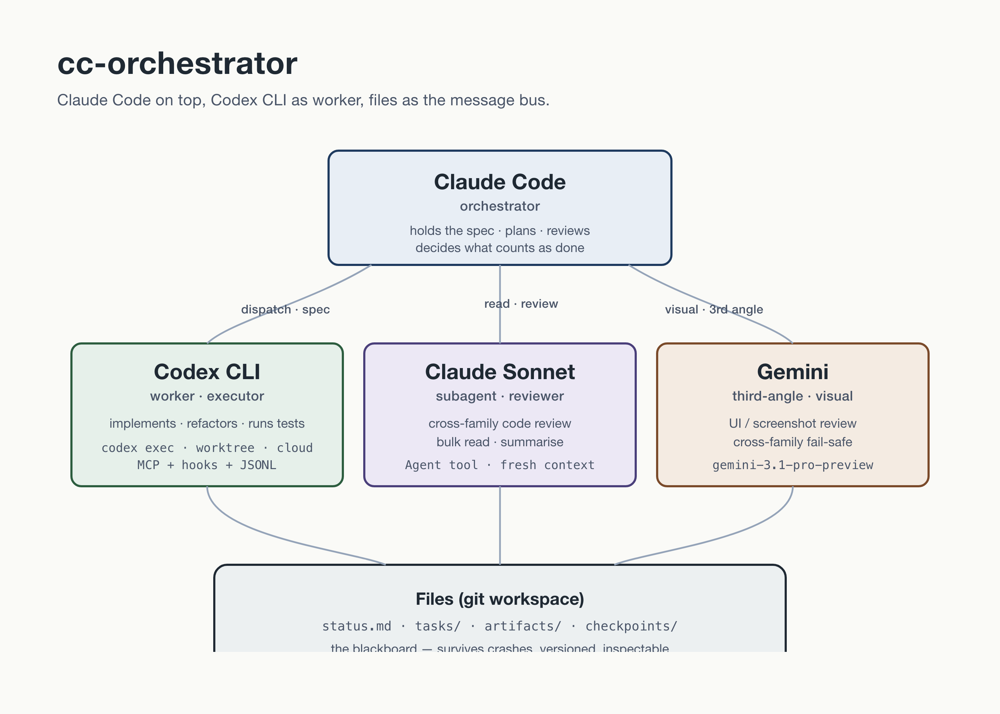

  

# cc-orchestrator

> **🐧 English** — [README.md](README.md) · [中文長文](https://penchan.co/ai/orchestration-playbook/)

**用 Claude Code 當 orchestrator，把 Codex CLI 當 worker。中間那層官方文件留給你自己摸的東西，這份 repo 全部記下來了。**

如果你已經在用 Claude Code 開 subagent，簡單那半你已經會：「叫一個 subagent 去做 X」。難的那半在外圍——什麼時候交給 Codex 比交給 Claude subagent 划算、effort tier 怎麼選才能讓週度 credit 撐到下週、sandbox 怎麼準確處理你的 `npm install`、stdout 報的成功要怎麼用三個訊號交叉驗。這份 repo 就在處理這一層。

---

## 為什麼有這個 repo

2026 年最能打的兩條 AI coding stack——Anthropic 的 Claude Code 和 OpenAI 的 Codex CLI——當初各自獨立設計。它們各有官方文件，**兩個放在一起怎麼跑**這件事住在你的 terminal history 裡。

兩邊都摸過幾週後，自然會分出一個分工：

- **Claude Code 在上面**：規劃、審查、把 spec 抓在手上、決定什麼叫「做完了」。
- **Codex CLI 在下面**：寫 code、refactor、生 tests、跑長 edits。

寫成投影片很乾淨。實際做下去縫隙到處都是——sandbox 邊界、effort tier 成本、observability、hook 的漏洞、`/compact` 怎麼把一個跑了 30 分鐘的 session 弄死、`--full-auto` 是一個具體的 approval policy 而不是「什麼都不問」。這份 repo 把這些事情的工作筆記，整理成你能直接抄走的 pattern。

## 這份 repo 適合誰

- Claude Code 是你每天的 daily driver，想開始用 Codex CLI 當 worker，需要一份起手規則可以擴。
- 你撞到 Codex sandbox 報錯，想快速判斷是 path、network、還是 policy 的問題——把整個下午留給出貨而不是猜題。
- 你想要 orchestration pattern 在出事的時候大聲喊出來，讓你能對著真訊號做事。

## 涵蓋範圍

| 主題 | 在哪查 |
|---|---|
| Operational pattern + prompt template（markdown，免安裝） | **這裡** |
| Codex CLI 入門（首次安裝、基本呼叫） | [Codex CLI 官方文件](https://developers.openai.com/codex/) |
| Claude Code 入門（session、subagent、tool 用法） | [Anthropic Claude Code 文件](https://docs.claude.com/en/docs/claude-code/overview) |
| 已驗版本 | Codex CLI 0.124 + Claude Code 2026 年 4 月版。抽象 pattern 可移植，操作細節（effort tier、hook event 名稱、sandbox flag）對應這兩個版本。 |

---

## 從哪裡開始

5 分鐘版本：

1. 讀 **[guides/orchestrating-codex.md](guides/orchestrating-codex.md)**——主打 guide。4-Lane 模型（local · worktree · cloud · MCP+hooks）、effort 怎麼選、一個能跑的 dispatch 長什麼樣。
2. 掃過 **[patterns/coordination/file-blackboard.md](patterns/coordination/file-blackboard.md)**——所有 multi-agent 系統都需要一個，這裡用的是這版。
3. 找一個你正在卡的具體問題，跳到對應 pattern。

1 小時版本：

| 你卡在…                             | 讀這個                                                                                                                                                         |
| -------------------------------- | ----------------------------------------------------------------------------------------------------------------------------------------------------------- |
| 怎麼包一個 task envelope，讓 Codex 跑在軌上 | [Task Envelope](patterns/coordination/task-envelope.md)                                                                                                     |
| Codex 一直 retry 把 credit 燒光       | [Circuit Breaker](patterns/resilience/circuit-breaker.md)                                                                                                   |
| Subagent 跑完了但什麼有用的訊息都沒回          | [Completion Notification](patterns/communication/completion-notification.md) + [Structured Error Events](patterns/communication/structured-error-events.md) |
| 判斷什麼時候該讓 Codex 自主跑、什麼時候該 escalate 給你 | [HITL Escalation](patterns/communication/hitl-escalation.md)                                                                                                |
| 長任務跑到一半死掉，你不知道死在哪一步              | [Checkpoint & Resume](patterns/resilience/checkpoint-resume.md)                                                                                             |
| Codex 自己審自己的 diff 漏東西            | [Cross-family review](guides/code-review.md) + [Challenge Loop](patterns/coordination/challenge-loop.md)                                                    |

---

## Repo 裡有什麼

### `guides/`——什麼時候做、為什麼這樣做

思考層。需要做決策（不是抄 pattern）的時候讀這些。

| Guide                                                        | 什麼時候讀                                                          |
| ------------------------------------------------------------ | -------------------------------------------------------------- |
| **[Orchestrating Codex](guides/orchestrating-codex.md)**     | 第一次接 CC ↔ Codex 工作流，或每次需要回憶哪個 sandbox flag 是做什麼用的 |
| [Model Selection](guides/model-selection.md)                 | 在判斷這個 task 該丟 Sonnet subagent / Codex `medium` / Codex `xhigh` |
| [Spec-Driven Development](guides/spec-driven-development.md) | 派 Codex 之前 prompt 想超過一行——先看這個                                  |
| [Code Review](guides/code-review.md)                         | 為什麼 cross-family review 比 self-review 強，要怎麼配                   |
| [Development Pipeline](guides/development-pipeline.md)       | code 跟 algo 開發的 phase-based 流程                                 |
| [Error Handling](guides/error-handling.md)                   | 5 層 fallback 金字塔；retry vs. restart vs. escalate 決策樹            |
| [Cost Control](guides/cost-control.md)                       | Per-task budget、credit window 數學、安靜燒錢的 anti-pattern            |
| [Context Management](guides/context-management.md)           | Prompt 控制在 8K 內、為什麼傳 path 不貼全文                                 |
| [Security Guardrails](guides/security-guardrails.md)         | 工具權限、路徑限制、prompt injection 防護                                  |
| [Learning Loop](guides/learning-loop.md)                     | 失敗變預防：debug KB、error SOP、quarterly audit                       |

### `patterns/`——具體的操作形狀

按解決的問題分三類，每個 pattern 都很短，有「什麼時候用得上」這行，加一個讓 pattern 派上用場的範例。

**`coordination/`——orchestrator 跟 worker 怎麼配在一起**

- [File Blackboard](patterns/coordination/file-blackboard.md) — workspace 就是 message bus
- [Task Envelope](patterns/coordination/task-envelope.md) — 每次 dispatch 的結構化包裝
- [Challenge Loop](patterns/coordination/challenge-loop.md) — 證據受限的對抗式審查

**`resilience/`——某一塊死掉的時候怎麼撐住**

- [Circuit Breaker](patterns/resilience/circuit-breaker.md) — retry 風暴在燒到你之前先停下來
- [Checkpoint & Resume](patterns/resilience/checkpoint-resume.md) — session 半途死了怎麼救
- [Dead Letter Queue](patterns/resilience/dead-letter-queue.md) — 失敗的 task 留在 queue 等重跑

**`communication/`——狀態跟失敗怎麼說出來**

- [Completion Notification](patterns/communication/completion-notification.md) — 做完了就要說，獨立訊息回報
- [Structured Error Events](patterns/communication/structured-error-events.md) — 讓失敗大聲喊
- [HITL Escalation](patterns/communication/hitl-escalation.md) — 三層 human-in-the-loop gating

### `templates/`——可以直接抄的起點

Markdown 跟 JSON template，包含 envelope、error event、checkpoint、decision card、dead letter。拿一份、填進去、上線。

### `examples/cc-orchestrate-cod/`——能跑的最小範例

最小 end-to-end working example：一個 orchestrator、一個 Codex worker、file blackboard、circuit breaker、completion notification。讀一遍、fork 走、把 task 換成你的。

---

## 30 秒架構

  

關鍵性質：

- **Hierarchical 分層**：一個 orchestrator 擁有 global state，worker 跑無狀態、做完回報。
- **檔案就是 message bus**：所有協調都透過磁碟上的 markdown 跟 JSON。Crash 也活得下來。
- **預設 cross-family review**：寫 code 的模型把 diff 交給另一個 family 的模型來審。
- **Codex 在 worker 那層**：跑在 sandbox 裡、為執行優化；orchestrator 角色住更上面，在那裡做 spec、review、預算判斷。

為什麼長這樣？因為 Claude Code 的 subagent 是無狀態、彼此只透過檔案溝通；因為 `/compact` 超時 Codex session 會直接死；因為兩邊唯一可靠的共享狀態就是 filesystem。架構是順著限制長出來的。

---

## 學最久才學會的六件事

1. **`codex exec --full-auto` 等於 `-a on-request -s workspace-write`**：headless 跑要加 `-a never`，worker 才不會停在 approval prompt。
2. **Codex sandbox 預設網路關閉**：任務需要 `npm install` 時顯式加 `-c sandbox_workspace_write.network_access=true`——開一個 flag 比關 sandbox 安全。
3. **成功要看三個訊號**：exit code 0 + JSONL stream 裡有 `turn.completed` event + `--output-last-message` 寫的 sidecar 真的落地。三件都對才算數，單看一件會被騙。
4. **把 30 分鐘當作單個 Codex run 的上限**：超過這個點 `/compact` 可能 timeout，`codex resume` 拿到的是死 session。把工作切成 ≤25 分鐘的段、每段寫 digest、要續接就開新 session。
5. **把 code review 交給另一個 model family**：self-review 有 64.5% 盲點——寫 code 的模型跟審 code 的模型同 prior。所以 Claude Code 在上面 orchestrate，Sonnet 在下面做 cross-family review。
6. **三個並行 worker 是甜蜜點**：Codex Pro 上第四條 worktree 會撞 5-hour credit window。上限 3。

---

## 設計原則

| 原則                    | 意思                                                         |
| --------------------- | ---------------------------------------------------------- |
| **Worker over peer**  | Orchestrator 派任務、做決策。Worker 執行、回報，把 delegate 留給上一層。 |
| **File over wire**    | 所有協調都透過檔案。Pattern 唯一依賴的 message bus 是 filesystem。 |
| **Crash-only design** | 任何 worker 隨時可以死掉。Checkpoint 讓這變成例行事件。 |
| **預設 budget-aware**   | 每次 dispatch 都有成本上限。Circuit breaker 會強制執行。 |
| **吵鬧失敗 > 安靜成功**       | 大聲失敗的 worker 比默默失敗的容易修。強制 structured event。 |
| **壓縮，留路重開**           | Phase 結束就壓成 summary。長 session 用 checkpoint 換新 session 接續。 |

---

## 貢獻

歡迎 PR：

- 新的 operational pattern + 真實 production evidence——附上是什麼 failure 讓你寫這個 pattern。
- 特定平台或 stack 的 template（Aider、Cline、自訂 CC script）。
- War story：寫清楚的 failure mode + 你最先試了什麼。

提 pattern 的時候請寫上**什麼時候撞到問題**、**第一次嘗試試了什麼但沒成功**，加上最終解。前半段才是讓這個 pattern 對其他人有用的部分。

## 姊妹 repo

這份 repo 在講「orchestration 怎麼跑下去」。如果問題是**該選哪一種 multi-agent topology**（Panel？Tournament？Debate？平層 hierarchy？），以及哪些 topology 真的值得用——看 **[multi-agent-patterns](https://github.com/p3nchan/multi-agent-patterns)**：設計時看的姊妹 repo，這份是執行時看的。

## 研究基礎

裡面的 pattern 跟 guide 來自：

- 2026 年 4 月做的多軌 deep research synthesis：AI-assisted software engineering（SWE-bench 生態、MetaGPT、AgentCoder、FunSearch、AlphaCodium、MAST failure taxonomy）+ 量化策略生命週期（2018–2026 學術文獻 + Two Sigma、D.E. Shaw、Man AHL、Winton、Jane Street 等實務文獻）。
- Codex CLI 0.124.0 官方文件 + Codex Use Cases，跟另一份 2026 年 4 月做的 Codex orchestration deep research 交叉驗證（`guides/orchestrating-codex.md` 的來源）。
- Anthropic Claude Code 官方文件、2026 年 3 月 harness-design 筆記、官方公布的 orchestrator + subagent pattern。
- 在多個專案上實際跑這套 stack 幾個月的 production 經驗。

引用住在各個 guide 裡。

## License

MIT——這些 pattern 你想怎麼用都行。

---

*Penna 寫 ([penchan.co](https://penchan.co))——每天用 Claude Code + Codex 的工程師，在 [@p3nchan](https://www.threads.net/@p3nchan) 寫中文 AI 工作流長文。Repo 裡每一個 pattern 都對應到一次「沒這個就會壞」的事故。*
